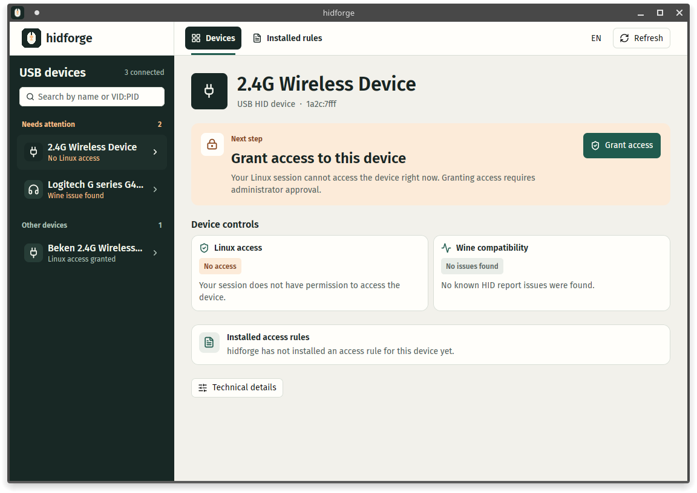

<p align="center">
  <picture>
    <source media="(prefers-color-scheme: dark)" srcset="assets/brand/hidforge-horizontal-reversed.svg">
    
  </picture>
</p>

# hidforge

Make Windows-only keyboard and mouse software work on Linux.

Many peripherals ship their settings app (DPI, RGB, macros) for Windows only. You can run it
under Wine or Bottles, but it often either can't find the device or can't change its settings.
hidforge fixes both from a simple desktop app: it installs a udev rule so your user can access
the device, and loads a small HID-BPF fix into the kernel when Wine misreads the device's
descriptor.

<p align="center">
  
</p>

## What it does

- Lists your USB devices and puts the ones that need attention first.
- Installs a udev rule so your user, not just root, can talk to the device.
- Detects devices whose descriptor Wine misreads (so settings never reach them) and loads a
  kernel fix for that device only.
- Shows the install command for your distribution when a required package is missing.

Anything that needs root asks for your password through polkit.

## Install

Download a file from the [latest release](https://github.com/Enes5519/hidforge/releases/latest)
(x86_64):

- **Debian/Ubuntu:** `sudo apt install ./hidforge_<version>_amd64.deb`. Updates and removal go
  through apt.
- **Any distribution:** the AppImage (`chmod +x` it and run it) or the `tar.gz` (extract it and
  run `./hidforge`).

The AppImage and tarball need a one-time setup on first start. hidforge runs its root part,
`hidforge-helper`, from `/usr/libexec` with a polkit policy, so press **Install helper** and enter
your password. A newer download offers **Update helper**, and the **System helper** card under
**Installed rules** removes it. Removing it leaves your rules and Wine fixes in place.

<details>
<summary>Verifying the download</summary>

```sh
sha256sum -c --ignore-missing SHA256SUMS
gh attestation verify <file> --repo Enes5519/hidforge   # built by this repo's release workflow
```

The helper setup installs whatever download you run it from, as `sudo ./install.sh` would. It
won't downgrade a newer helper or replace one it didn't install, but it doesn't check
signatures, so verify the file first.

</details>

<details>
<summary>Building from source</summary>

You need Rust 1.88 or newer and the libraries gpui (the GUI toolkit) links against. On
Debian/Ubuntu:

```sh
sudo apt-get install libasound2-dev libfontconfig-dev libwayland-dev libx11-xcb-dev \
  libxkbcommon-x11-dev libssl-dev libzstd-dev libvulkan-dev
cargo build --release --locked
```

Run `target/release/hidforge` and press **Install helper**: it installs the `hidforge-helper`
built next to it. **Update helper** appears only when the version number goes up, not when you
rebuild the same version.

Packagers can install the helper by hand instead. hidforge then leaves it alone, so you update
it yourself:

```sh
sudo install -Dm755 target/release/hidforge-helper /usr/libexec/hidforge-helper
sudo install -Dm644 assets/org.hidforge.helper.policy /usr/share/polkit-1/actions/org.hidforge.helper.policy
install -Dm755 target/release/hidforge ~/.local/bin/hidforge
```

Release builds use only the installed helper. A debug build (`cargo run`) falls back to the
helper next to it, with a generic password prompt, unless one is installed.

</details>

<details>
<summary>Launcher entry and icon (tarball and source builds)</summary>

The `.deb` installs these already. Without them Wayland shows no window icon. From the source
tree (in the tarball the files are `hidforge.desktop` and `icons/`):

```sh
install -Dm644 assets/hidforge.desktop ~/.local/share/applications/hidforge.desktop
install -Dm644 assets/brand/icons/hidforge.svg ~/.local/share/icons/hicolor/scalable/apps/hidforge.svg
for s in 16 24 32 48 64 128 256 512; do
  install -Dm644 assets/brand/icons/hidforge-$s.png ~/.local/share/icons/hicolor/${s}x${s}/apps/hidforge.png
done
```

The entry runs `hidforge` from your `PATH`, for example `~/.local/bin`.

</details>

## How to use

1. Open hidforge and pick your device. Devices with an access or Wine issue appear first under
   **Needs attention**.
2. Follow **Next step**: grant access first if needed, then install the Wine fix.
3. After a Wine fix, fully close Wine/Bottles and open your vendor software again.
4. **Installed rules** lists what hidforge installed and lets you remove it. **Technical
   details** has the access options, the rule preview and export.

The interface is in English and Turkish. It follows `LC_ALL`/`LC_MESSAGES`/`LANG`, and you can
switch it in the app (saved in `~/.config/hidforge/locale`).

## Requirements

- Linux with polkit.
- For the Wine fix: `udev-hid-bpf`, `clang`, libbpf and Linux UAPI headers, and kernel 6.11 or
  newer with `CONFIG_HID_BPF` and BTF. `hidforge --check` lists what's missing.

Developed and tested on Arch-based distributions. Debian, Fedora and openSUSE should work
(install commands are provided) but are untested.

<details>
<summary>Command line</summary>

```sh
hidforge --check                          # missing requirements and the install command (exit 1 if any)
hidforge --list                           # detected USB devices
hidforge --bpf-source /dev/hidrawN        # print the generated HID-BPF fix for a device
hidforge --bpf-source-raw VID:PID FILE    # same, from a saved report descriptor file
```

</details>

## Contributing

- Translations: copy `locales/en.yml` to `locales/<code>.yml` and translate the values. The
  language shows up in the app after a rebuild.
- Before a PR, run the checks CI runs: `cargo fmt --check`,
  `cargo clippy --all-targets -- -D warnings` and `cargo test`.
- Only `hidforge-helper` runs as root, never the GUI, and CI fails if the helper links the GUI
  toolkit. Keep it small and validate everything it reads.

## License

GPL-3.0-or-later. See [LICENSE](LICENSE). The HID-BPF programs hidforge generates and loads
into the kernel carry their own `GPL-2.0-only` header, as the kernel requires.
